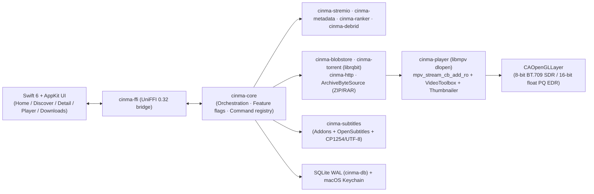

<p align="center">
  
</p>

<h1 align="center">Cinma</h1>

<p align="center">
  <strong>A native macOS Stremio addon client, P2P torrent streaming player and unified download manager, in one process, with no WebView and no telemetry.</strong><br>
  Apple Silicon (<code>arm64</code>) · macOS 15+ · Swift 6 + AppKit · Rust · libmpv
</p>

---

Cinma combines a **Swift 6 + AppKit (macOS Liquid Glass)** interface, a **Rust** core (`tokio`, `rusqlite`, `librqbit`), a **UniFFI** bridge and the hardware-accelerated **libmpv** player in a single native app process. Catalog browsing, smart stream ranking, Debrid resolution, instant P2P and archive streaming, and multi-segment downloads all run through a direct memory/disk bridge, with no external server or background daemon.

---

## Core principles

Development follows the rules fixed in [CLAUDE.md](CLAUDE.md) and the Architecture Decision Records under `docs/adr/`:

1. **One process.** No background service, `LaunchAgent` or sidecar streaming server. The only allowed child process is a short-lived `yt-dlp -J` call that extracts web video URLs. External players (IINA, VLC, Infuse) are opened through URL schemes or Launch Services, not as child processes.
2. **No WebView.** No Electron, Tauri or embedded browser. The whole UI is native **AppKit** (`NSCollectionView`, `NSTableView`, `NSGlassEffectView` / `NSVisualEffectView`), with SwiftUI only for small leaf panels.
3. **No `localhost` HTTP server for local playback.** The player reads bytes directly through libmpv's custom stream API (`mpv_stream_cb_add_ro`, `cinma://blob/<id>`). The single exception is the temporary in-process LAN HTTP `Range` server used for **Chromecast / DLNA**, which exists only while a cast session runs.
4. **No telemetry and no mandatory account.** No analytics, crash reporting service or remote config. Profiles, library, watch history and settings live in a local **SQLite** database (`WAL`, `STRICT` tables, schema v8). API keys and OAuth tokens are stored in the **macOS Keychain**.
5. **Lazy loading and modular features.** Disabled features (`Feature::{Addons, Torrent, Casting, Tracking, SkipSegments, Debrid, Iptv, Discord}`) are never instantiated: zero RAM and zero CPU when off. libmpv/FFmpeg load on first playback; the torrent session starts with the first torrent.
6. **No bundled content sources.** Cinma ships without stream addons; you add your own Stremio addon URLs or `stremio://` links.

---

## Architecture overview



### Rust workspace (`crates/`)

| Crate | Responsibility |
|---|---|
| `cinma-core` | Runtime, profiles and settings, `PlayerPreferences` & `SubtitleSettings`, command registry, event stream, orchestration |
| `cinma-db` | SQLite connection and migrations (`0001_init.sql` – `0008_phase9_integrations.sql`): profiles, library, progress, caches, outbox |
| `cinma-ffi` | The only FFI boundary Swift sees (UniFFI 0.32 records, async methods and callback interfaces) |
| `cinma-blobstore` | Sparse files, durable range bitmaps, `ByteSource` with priority signals, store-mode ZIP/RAR4/RAR5 `ArchiveByteSource` |
| `cinma-queue` | Priority-based unified download queue (`DownloadEngine`), crash recovery, live in-memory progress (`LiveProgressMap`) |
| `cinma-player` | Runtime-`dlopen` libmpv bridge, `mpv_stream_cb_add_ro`, FFmpeg/AVFoundation seek-bar thumbnailer, `libavformat` remuxer |
| `cinma-stremio` | Stremio Addon Protocol client (`manifest`, `catalog`, `meta`, `stream`, `subtitles`) with configurable HTTP timeout (3–60 s) |
| `cinma-torrent` | `librqbit` streaming engine driven by the read cursor, head+tail warm-up, single-copy download staging, VPN interface binding & kill switch |
| `cinma-ranker` | Parallel stream parsing, hardware AV1 detection (`sysctlbyname`), quality/HDR/codec/seeder scoring, word blocking, explainable ranking |
| `cinma-metadata` | TMDB v3 client (original titles, languages, watch providers, `/discover/{movie\|tv}`), Fanart.tv v3, Kitsu, AniSkip v2 & IntroDB |
| `cinma-subtitles` | Stremio addon + OpenSubtitles REST aggregator, 64 KiB head/tail hash, gzip, Turkish `windows-1254`/`ISO-8859-9` → UTF-8, SDH cleanup |
| `cinma-http` | Multi-segment HTTP/1.1 download engine with dynamic range splitting and `ETag`/`Last-Modified` resume |
| `cinma-casting` | In-process mDNS (Chromecast CastV2 TLS) and SSDP (DLNA AVTransport) discovery, plus a LAN `Range` server alive only while casting |
| `cinma-tracking` | Trakt device-code OAuth & two-way sync, Simkl/AniList/MAL (`cinma://oauth` PKCE), Letterboxd RSS/CSV, SQLite outbox, anime ID map |
| `cinma-debrid` | Real-Debrid, AllDebrid, Premiumize, TorBox, EasyDebrid and Debrid-Link: instant-cache checks and HTTPS stream resolution |
| `cinma-iptv` | M3U/M3U8, Xtream Codes and XMLTV EPG parsing and caching |
| `cinma-discord` | In-process Discord Rich Presence client over `$TMPDIR/discord-ipc-{0..9}` |

### Swift / AppKit layer (`app/Cinma/`)

- **Browsing:** `AppDelegate`, `MainShellViewController`, `HomeBrowserViewController`, `HomeRailsSheet`, `DiscoverViewController`, `TitleDetailViewController`, `LibraryCalendarViewControllers`, `LiveTvViewController`, `PosterCards`.
- **Playback:** `PlayerViewController` (+ extensions), `PlayerHelpers`, `PlayerMenus`, `MiniPlayerPanel` (zero-copy floating PiP `NSPanel`), `VideoLayer`.
- **Settings, downloads and system integration:** `SettingsView`, `SheetsAndSettings`, `IntegrationsView`, `DownloadsViewController`, `MenuBarController`, `DesignSystem`, `ImagePipeline`, `CalendarNotifications`, `SpotlightAndIntents`, `GamepadController`.
- **Full English + Turkish localization:** about 960 strings in `app/Cinma/Localizable.xcstrings`, none missing a Turkish translation.

The numbered feature inventory (`#01`–`#80`, in Turkish) is in [ozellikler.md](ozellikler.md).

---

## Features

### Browsing, catalogs, metadata and calendar
- **Instant launch from SQLite:** Home draws cached *Continue Watching* and popular rows first, then refreshes from the network. The hero rotation pauses when the window is hidden or in the background.
- **Customizable Home:** pick which addon catalogs appear as rails (*Customize Home Rails…*, in addon order), pin any catalog + genre as a shelf, keep *Continue Watching* on top, hide nearly finished items (≥ 85 %), and tune poster scale (80–125 %), corner radius (4–24 pt), titles and `IMDb` / type / watched / library badges.
- **Discover & streaming-platform filters:** catalogs grouped by addon, genre chips, incremental search, and optional **TMDB platform filters** (*Netflix, Disney+, Apple TV+, Prime Video, Max, Crunchyroll, MUBI*, movies or series).
- **TMDB + Fanart.tv + Kitsu + Cinemeta:** configurable metadata language (`en-US`, `tr-TR`, `de-DE`, `fr-FR`, `es-ES`, `ja-JP`), keep original titles, artwork language, title logos (ClearLogo) and *Where to Watch* provider logos.
- **Title page:** cast and director chips with person pages, film collections, spoiler protection (blur unwatched thumbnails, hide synopses), ascending/descending and compact episode lists, filler badges for anime.
- **Calendar & macOS integration:** week starts Monday or Sunday, local new-episode notifications (`UserNotifications`), `AppIntents` shortcuts and optional `CoreSpotlight` indexing.
- **Local and network libraries:** optional local folder scanner (`SxxExx` / year parsing) and direct WebDAV sources (Zurg, TorBox WebDAV, Nextcloud, NAS).

### Smart stream picker & Debrid
- **Parallel stream collection:** all installed stream addons are queried in parallel and the list updates as each one answers; the timeout (3–60 s) is configurable.
- **Explainable scoring and sorting:** resolution, HDR/Dolby Vision, codec (with hardware AV1 detection), audio, seeders, release group and language preference. Sort by score, seeders or size; block words (`CAM`, `HDCAM`, `TS`…); show raw file names; remember the source per series.
- **Format badges:** stream rows show styled badges for 4K UHD, FHD, HDR10/HDR10+/HLG, Dolby Vision, Dolby Atmos/Digital, DTS and codecs.
- **Debrid resolvers:** six providers with keys stored in Keychain; cached streams are promoted as `[Instant Debrid]`, and a **Debrid-only** mode hides raw P2P torrents entirely.
- **Quick Play:** start the best (or cached) stream straight from a poster, the hero or the title page; ⌥-click opens the picker.

### Player, HDR/EDR, audio & controls
- **Adaptive surface and tone mapping:** lightweight 8-bit `BT.709` for SDR, 16-bit float `PQ / macOS EDR` for HDR. Live tone-mapping menu (`Auto`, `BT.2390`, `Reinhard`, `Hable`, `Clip`), target peak (400–1600 nits), scaler presets, VideoToolbox hardware decoding, 4–128 MiB demuxer buffer, extra `mpv` options and an adaptive CAS sharpening shader.
- **Stream details (globe) and P2P status:** download/upload speed, active/total peers, cache percentage, file name, `InfoHash`, `hwdec`, cache duration and dropped frames, live.
- **Comfort & automation:**
  - Intro / recap / outro skip button or auto-skip from AniSkip, IntroDB and chapters, plus per-series manual markers.
  - Next-episode warm-up at 88 %, audio/subtitle/video preferences kept across episodes of the same source, configurable countdown and *"Still watching?"* threshold.
  - Automatic retry and switch to the next stream when playback stalls.
  - Network-free seek-bar thumbnails, chapter markers, A/B loop, aspect/crop modes (`fit`, `fill`, `16:9`, `21:9`, `4:3`), screen lock, fullscreen clock with end time, volume HUD, 100/150/200 % volume boost, `dynaudnorm` normalization, stereo downmix, sleep timer (including *stop after this episode*), always-on-top, screenshots and zero-copy floating PiP.
  - Live Text on paused frames (VisionKit), hold-to-speed-up, frame stepping, trackpad gestures with haptics, game controller support and a remappable shortcut registry.
  - Optional hand-off to an external player (IINA, VLC, Infuse) and confirmation for `stremio://` deep links.

### Subtitles
- Stremio subtitle addons + OpenSubtitles REST API v1 (account sign-in, remaining quota, 64 KiB head/tail hash matching), with per-provider toggles.
- Automatic conversion of Turkish `windows-1254` / `ISO-8859-9` and UTF-16 files to UTF-8, `[effect]` / `(SDH)` cleanup, dual subtitles (`secondary-sid`, top or bottom), forced-only subtitles for native audio, keep or override ASS/SSA styling, scale with window.
- Live styling from the player's *Appearance* tab: **size, 50–150 % scale, position, text opacity, background box opacity, alignment, color presets, black outline, bold text, and lift above the control bar**. Dialogue search (⌘F) jumps to any line; HDR subtitle brightness cap and letterbox placement.

### Downloads, theme & integrations
- **Download queue:** single-copy torrent downloads (`~/Movies/Cinma/.cinma-partial/<hash>`, hard-linked into place when done), multi-segment HTTP/1.1, `yt-dlp -J` with in-process `libavformat` muxing (`~/Movies/Cinma` and `~/Music/Cinma`), **Play Now** while downloading, upload/download limits applied live, seeding policies, VPN interface binding (`utun*`) with kill switch, a download scheduler and menu bar tracking. Interrupted downloads resume at launch.
- **Streaming from archives:** play videos inside store-mode ZIP and RAR4/RAR5 torrents without extracting them (`ArchiveByteSource`).
- **Integrations (off by default):** Chromecast/DLNA casting, Trakt / Simkl / AniList / MAL sync (`cinma://oauth` PKCE + offline SQLite outbox), Letterboxd RSS and CSV export, Stremio account import, Live TV/IPTV (`M3U`, `Xtream`, `XMLTV`), Discord Rich Presence with privacy filters, and an opt-in local control socket (`cinma.sock`, JSON-RPC).
- **Theme & personalization:** accent colors (*Amber, Crimson, Cyan, Emerald, Violet*), a flat-surface mode that reduces Liquid Glass transparency and GPU use, backdrop dimming, hideable navigation tabs and an in-app `EN`/`TR` interface language.

---

## Measurements

All automated measurements were taken on Apple Silicon (`arm64`) with the `Release` configuration, using [tools/measure.sh](tools/measure.sh) and [tools/measure-playback.sh](tools/measure-playback.sh). Results are appended to [tools/measurements.csv](tools/measurements.csv).

### 1. Launch, idle memory (footprint) and playback: targets vs measurements

| Scenario / metric | Target ([CLAUDE.md §6](CLAUDE.md#6-targets-apple-silicon-m1-baseline)) | Measured (Release / automated) | Real-world observation (Release UI) | Status |
|---|---|---|---|---|
| **Cold launch → first frame** (`first_frame_ms`, median of 5) | `< 250 ms` | **164.1 – 184.2 ms** (2026-11-19: 173 ms) | ~170 ms | ✅ |
| **Idle, empty window** (`phys_footprint`) | `≤ 70 MB` | **28 – 34 MB** (RSS ~100 MB) | — | ✅ |
| **Menu bar only (window closed, queue idle)** | `≤ 40 MB` | **28 MB**, 0.00 % CPU | — | ✅ |
| **Idle with Home loaded** (Cinemeta artwork + hero rotation, 30 s) | `≤ 200 MB`, `≤ 0.5 % CPU` | **135 MB**, **0 % CPU** (2026-11-19; previously 172 MB / 0.17 %) | ~260 MB after a long browsing session (image + AppKit caches) | ✅ |
| **1080p torrent playback** (*Cowboy Bebop 1080p*) | Smooth hwdec playback | Synthetic 1080p SDR MKV: 378 MB footprint, TTFF 383.9–422.0 ms, seek 79.6–189.7 ms | ~370 MB on a real Torrentio stream | ✅ |
| **4K / high-bitrate playback** (*The Odyssey*) | `< 20 % CPU`, `≤ 700 MB` | Synthetic 4K HEVC HDR10 (2026-11-19): **15 % CPU**; footprint depends on window size: **590 MB** (1280×800), **683–689 MB** (1920×975 window on a 4K external display); TTFF 315 ms | ~460 MB on a real 4K stream | ✅ |
| **Idle CPU (empty window)** | `~0 %` | **0.00 %** | 0 % | ✅ |
| **Loopback torrent stream (6 MB/s)** | `< 5 s TTFF`, `< 2 s seek` | TTFF **192 – 205 ms**, seek **953 ms – 1.3 s** | Real swarms depend on the network | ⚠️ (not measurable in the agent sandbox) |

> **Notes:**
> - **`tools/measure.sh` history:** Phase 0 (150.5 ms, 20.0 MB), Phase 3 (170.2 ms, 29.0 MB), Phase 4 (170.5 ms, 28.0 MB), Phases 5–7 (181.8 ms, 30.0 MB), Phase 8 (164.1 ms, 30.0 MB), Phase 9 (184.2 ms, 31.0 MB, 0.00 % CPU), 2026-11-19 (173 ms, 34 MB).
> - **Large-file streaming optimization (`bf1dc3a`):** tighter image memory limits, dropping the browse image cache during playback, and demuxer/buffer limits brought real streams down to **~460 MB at 4K** and **~370 MB at 1080p**.

### 2. Tests and quality

| Check | Result |
|---|---|
| `cargo fmt --check` | **Pass** |
| `cargo clippy --all-targets -- -D warnings` | **Pass** (0 warnings) |
| `cargo test --workspace` | **147 tests pass**, 0 failed (including `kill -9` crash tests, ZIP/RAR archive streaming, OpenSubtitles/CP1254, Debrid/ranker, PKCE OAuth, IPTV, Discord IPC, loopback torrent download/pause/resume, single-copy storage) |
| `xcodebuild -configuration Release` (`Cinma.app`) | **BUILD SUCCEEDED**, 0 compiler warnings |
| `Localizable.xcstrings` (`en` + `tr`) | about 960 strings, 0 missing Turkish translations |

---

## Building

### Requirements
- **macOS 15+** on Apple Silicon (`arm64`)
- **Xcode 16+** / Xcode Command Line Tools
- **Rust 1.85+ (edition 2024)** with the `aarch64-apple-darwin` target
- **mpv + FFmpeg** (loaded at runtime with `dlopen`; see [ADR 0005](docs/adr/0005-libmpv-from-homebrew.md)):
  ```bash
  brew install mpv ffmpeg
  ```
- *(Optional)* `yt-dlp`, installable with one click from Settings → Downloads (verified against the release's SHA-256 sums).

### Build commands

```bash
# 1. Build the Rust core and the UniFFI Swift bindings (app/Generated/)
tools/build-core.sh Release

# 2. Build the Release macOS app (also runs the Xcode "Build Rust core" phase)
xcodebuild -project app/Cinma.xcodeproj -scheme Cinma -configuration Release \
  -destination 'platform=macOS,arch=arm64' -derivedDataPath build/xcode build

# 3. Launch the app
open build/xcode/Build/Products/Release/Cinma.app

# (Optional) Package a portable .app with libmpv.2.dylib and its dependencies bundled:
BUNDLE_LIBMPV=1 tools/package-release.sh
```

### Tests and measurement tools

```bash
# All Rust tests and Clippy
cargo clippy --all-targets -- -D warnings
cargo test --workspace

# Launch time, idle footprint and CPU (appends to tools/measurements.csv)
tools/measure.sh

# TTFF and seek latency with a real Stremio addon
tools/measure-playback.sh "https://ADDON_URL/manifest.json" movie tt0111161 5
```

<details>
<summary>Developer automation environment variables (<code>DevAutomation.swift</code>)</summary>

Inert unless set; used only for tests and measurements:

- `CINMA_MEASURE=1`: print launch (`CINMA_FIRST_FRAME_MS`, `CINMA_CORE_READY_MS`), TTFF and seek times to `stderr`.
- `CINMA_DATA_DIR=/tmp/cinma-test`: use a custom data directory.
- `CINMA_DEV_ADDON=...`: install a test addon at launch.
- `CINMA_AUTOPLAY=movie:tt...|file:/path/video.mkv`: start playback at launch.
- `CINMA_AUTOSEEK=0.5,0.85`: seek to these fractions automatically.
- `CINMA_AUTOQUIT=1`: quit cleanly when the measurement ends.
- `CINMA_LIBMPV=/custom/libmpv.2.dylib`: use a custom libmpv.
- `CINMA_DEV_PEERS=127.0.0.1:6999`: add an offline loopback seeder as a peer.

</details>

---

## Roadmap

Phases 0–9 and the lightweight Harbor settings-parity waves are complete. Next steps are tracked in [docs/ROADMAP.md](docs/ROADMAP.md) and [docs/RISKS.md](docs/RISKS.md).

### Phase 10: hardening, packaging and owner tests (next)
- [ ] **Bundled minimal libmpv + FFmpeg (ADR 0015):** embed custom minimal binaries under `Contents/Frameworks/` so a Homebrew upgrade cannot break the ABI, and drop the `disable-library-validation` entitlement.
- [ ] **Real media corpus (`tools/media-corpus.md`):** verify Dolby Vision P5/P8/P7, hardware AV1, ASS-heavy anime and multi-audio files on real hardware; if needed, evaluate `vo=gpu-next` + `macvk`/`libplacebo` (ADR 0004, option D1).
- [ ] **Real-swarm TTFF / seek tuning:** measure the `< 5 s` TTFF / `< 2 s` seek targets on real P2P swarms with `tools/measure-playback.sh` and tune librqbit's window parameters.
- [ ] **Memory fragmentation trial:** compare `mimalloc` / `jemalloc` against the ~113 MB malloc fragmentation left after a torrent session ends.
- [ ] **Crash safety & hygiene:** more `kill -9` tests for yt-dlp muxing and backup restore, and a one-click **Copy diagnostics** button (local version and error summary only).
- [ ] **Live device & account checks:** real Chromecast/DLNA TVs, Trakt/Simkl/AniList/MAL OAuth round trips, Real-Debrid/AllDebrid keys and the `utun*` VPN kill switch on a live network.

### Deferred on purpose (system load)
- *Anime4K multi-pass GLSL shader packs:* left out to avoid GPU load and heat; could come later as an opt-in for anime only.
- *Auto-playing trailers on the title page:* kept off so `yt-dlp` plus a silent background `mpv` preview don't raise idle RAM; a manual **Trailer** button is available.
- *Downloading the next episode in full ahead of time:* the head+tail warm-up at 88 % already covers it, so full downloads were deferred to save SSD writes and bandwidth.
- *More direct subtitle REST providers (`SubDL`, `SubSource`, `Wyzie`, `Jimaku`):* can be added as modules where Stremio addons and OpenSubtitles fall short.
- *External webhook notifications and a fullscreen 10-foot TV mode:* out of scope for a single-process desktop app. (Game controller support was added; see `ozellikler.md` #39.)

---

## Documentation and decision records

- [CLAUDE.md](CLAUDE.md): standing architecture brief, targets and constraints
- [PROGRESS.md](PROGRESS.md): phase-by-phase progress, fixes and verification history
- [docs/ROADMAP.md](docs/ROADMAP.md): owner checklist, pitfalls learned and the Phase 10 plan
- [docs/RISKS.md](docs/RISKS.md): open risks and the limits of offline verification
- [docs/adr/](docs/adr): 17 Architecture Decision Records (`0001` – `0017`)
- [ozellikler.md](ozellikler.md): numbered feature inventory (Turkish)
