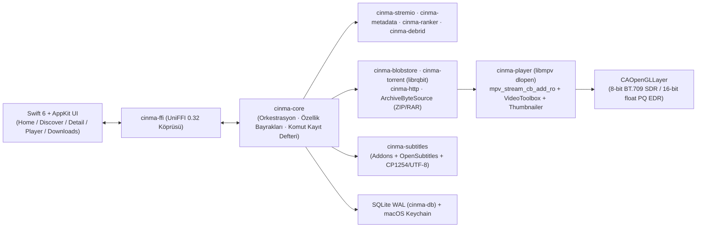

# Cinma

**Apple Silicon (`arm64`, macOS 15+) için tek süreçli (single-process), sıfır WebView ve sıfır telemetri ilkesiyle geliştirilmiş yerel Stremio eklenti istemcisi, P2P torrent akış oynatıcısı ve birleşik indirme yöneticisi.**

Cinma; **Swift 6 + AppKit (macOS Liquid Glass)** arayüzünü, **Rust** çekirdeğini (`tokio`, `rusqlite`, `librqbit`), **UniFFI** köprüsünü ve donanım hızlandırmalı **libmpv** oynatıcısını tek bir yerel uygulama sürecinde birleştirir. Katalog gezinme, akıllı akış sıralama, Debrid ön-çözümleme, anında P2P/arşiv akışı ve çok parçalı indirme yönetimi dış bir sunucu veya arka plan daemon'u olmadan doğrudan bellek/disk köprüsü üzerinden çalışır.

---

## Temel Mimari İlkeler

Cinma'nın tüm geliştirme süreci [CLAUDE.md](CLAUDE.md) ve `docs/adr/` altındaki Mimari Karar Kayıtları ile sabitlenen şu kurallara dayanır:

1. **Tek Süreç (`Single-Process`):** Arka plan servisi, `LaunchAgent` veya sidecar streaming sunucusu çalıştırmaz. İzin verilen tek kısa ömürlü alt süreç yalnızca YouTube/web video ayıklaması yapan `yt-dlp -J` çağrısıdır.
2. **Sıfır WebView:** Electron, Tauri veya gömülü tarayıcı yoktur. Tüm arayüz yerel **AppKit** (`NSCollectionView`, `NSTableView`, `NSGlassEffectView` / `NSVisualEffectView`) ve küçük yaprak paneller için SwiftUI ile çizilir.
3. **Yerel Oynatmada `localhost` HTTP Sunucusu Yok:** Oynatıcı veriyi doğrudan `libmpv`'nin özel akış API'si (`mpv_stream_cb_add_ro` — `cinma://blob/<id>`) ile okur. Tek istisna **Chromecast / DLNA** yayınında açılan, yayın bittiğinde hemen kapatılan geçici süreç içi LAN HTTP `Range` sunucusudur.
4. **Sıfır Telemetri ve Zorunlu Hesap Yok:** Analitik, hata raporlama servisi veya uzak yapılandırma yoktur. Profil, kütüphane, izleme geçmişi ve ayarlar yerel **SQLite (`WAL`, `STRICT` tablolar, şema v8)** üzerinde tutulur; API anahtarları ve OAuth belirteçleri **macOS Keychain** içinde saklanır.
5. **Tembel Yükleme ve Modüler Özellik Sınırları:** Kapalı olan özellikler (`Feature::{Addons, Torrent, Casting, Tracking, SkipSegments, Debrid, Iptv, Discord}`) asla nesneleştirilmez (0 RAM ve 0 CPU maliyeti). `libmpv`/FFmpeg ilk oynatmada, torrent oturumu ise ilk torrent isteğinde yüklenir.
6. **İçerik Kaynağı İçermez:** Varsayılan akış eklentisiyle gelmez; kullanıcı kendi Stremio eklenti URL'lerini veya `stremio://` bağlantılarını ekler.

---

## Mimari Genel Bakış



### Rust Çalışma Alanı (`crates/`)

| Crate | Sorumluluk |
|---|---|
| `cinma-core` | Çekirdek çalışma zamanı, profil/ayar yönetimi, `PlayerPreferences` & `SubtitleSettings`, komut kayıt defteri, olay akışı, orkestrasyon |
| `cinma-db` | SQLite bağlantı/migrasyon katmanı (`0001_init.sql` – `0008_phase9_integrations.sql`), profiller, kütüphane, ilerleme, önbellek, outbox |
| `cinma-ffi` | Swift tarafının gördüğü tek FFI sınırı (`UniFFI 0.32` kayıtları, asenkron metotlar ve geri çağırım arayüzleri) |
| `cinma-blobstore` | Seyrek (sparse) dosyalar, dayanıklı aralık bit eşlemleri, öncelik sinyalli `ByteSource`, sıkıştırmasız ZIP/RAR4/RAR5 `ArchiveByteSource` |
| `cinma-queue` | Öncelik tabanlı birleşik indirme kuyruğu (`DownloadEngine`), çökme sonrası kurtarma ve canlı bellek içi ilerleme haritası (`LiveProgressMap`) |
| `cinma-player` | Çalışma zamanı `dlopen` tabanlı `libmpv` köprüsü, `mpv_stream_cb_add_ro`, FFmpeg/AVFoundation seek-bar küçük resim üretici ve `libavformat` remuxer |
| `cinma-stremio` | Stremio Addon Protokolü istemcisi (`manifest`, `catalog`, `meta`, `stream`, `subtitles`), yapılandırılabilir HTTP zaman aşımı (`3–60 sn`) |
| `cinma-torrent` | `librqbit` tabanlı okuma imleci öncelikli akış motoru, `head+tail` ön ısıtma, tek kopyalı indirme sahneleme, BSD VPN arayüz bağlama & kill switch |
| `cinma-ranker` | Paralel akış ayrıştırma, donanım AV1 tespiti (`sysctlbyname`), kalite/HDR/kodek/tohum puanlama, kelime engelleme, açıklamalı sıralama |
| `cinma-metadata` | TMDB v3 birincil istemcisi (orijinal başlık, dil, izleme sağlayıcıları, `/discover/{movie\|tv}`), Fanart.tv v3, Kitsu, AniSkip v2 & IntroDB |
| `cinma-subtitles` | Stremio eklenti + OpenSubtitles REST API toplayıcı, 64 KiB head/tail hash, gzip açma, Türkçe `windows-1254`/`ISO-8859-9` → UTF-8 dönüştürücü, SDH temizleme |
| `cinma-http` | Dinamik aralık bölmeli çok parçalı HTTP/1.1 indirme motoru (`ETag`/`Last-Modified` devam ettirme) |
| `cinma-casting` | Süreç içi mDNS (Chromecast CastV2 TLS) ve SSDP (DLNA AVTransport) keşfi + yalnızca yayın sırasında aktif LAN HTTP `Range` sunucusu |
| `cinma-tracking` | Trakt cihaz kodu OAuth & çift yönlü senkron, Simkl/AniList/MAL (`cinma://oauth` PKCE), Letterboxd RSS/CSV, SQLite outbox ve Anime ID eşlemi |
| `cinma-debrid` | Real-Debrid, AllDebrid, Premiumize ve TorBox önbellek kontrolü ve anlık HTTPS akış çözümleme |
| `cinma-iptv` | M3U/M3U8, Xtream Codes ve XMLTV EPG ayrıştırıcı ve önbellekleme |
| `cinma-discord` | `$TMPDIR/discord-ipc-{0..9}` üzerinden süreç içi Discord Rich Presence Unix soket istemcisi |

### Swift / AppKit Katmanı (`app/Cinma/`)

- **Gezinme ve Tarama:** `AppDelegate`, `MainShellViewController`, `HomeBrowserViewController`, `DiscoverViewController`, `TitleDetailViewController`, `LibraryCalendarViewControllers`, `LiveTvViewController`, `PosterCards`.
- **Oynatma ve Görüntü:** `PlayerViewController`, `PlayerHelpers`, `PlayerMenus`, `MiniPlayerPanel` (sıfır kopyalı yüzen PiP `NSPanel`), `VideoLayer`.
- **Ayarlar, İndirmeler ve Sistem Entegrasyonları:** `SheetsAndSettings`, `IntegrationsView`, `DownloadsViewController`, `MenuBarController`, `DesignSystem`, `ImagePipeline`, `CalendarNotifications`, `SpotlightAndIntents`.
- **Tam Çift Dilli Yerelleştirme:** `app/Cinma/Localizable.xcstrings` içinde **727 çevrilebilir İngilizce + Türkçe anahtar (`MISSING_TR_COUNT=0`)**.

---

## Tamamlanan Özellikler (Faz 0–9 + Harbor Ayar Eşitleme Dalgaları 1–5)

### Keşif, Katalog, Meta Veri ve Takvim
- **SQLite İlk Açılış:** Ana ekran önbellekli *İzlemeye Devam Et* ve popüler satırları anında çizer, ardından ağ verisini arka planda günceller; hero zamanlayıcısı pencere gizlendiğinde veya odak dışındayken durur.
- **Kişiselleştirilebilir Ana Sayfa & Kartlar:** *İzlemeye Devam Et* satırını üste sabitleme, neredeyse bitenleri (`≥ %85`) gizleme, dinamik eklenti katalog satırı sınırı (`0–15`), poster ölçeği (`%80–125`), köşe yuvarlaklığı (`4–24 pt`), başlık gizleme ve `IMDb` / `Film-Dizi` / `İzlendi` / `Kütüphane` rozetleri.
- **Keşfet & Akış Platformu Filtreleri:** Katalog seçimi, tür çipleri, artımlı arama ve isteğe bağlı **TMDB Yayın Platformu Filtreleri** (*Netflix, Disney+, Apple TV+, Prime Video, Max, Crunchyroll, MUBI* + Film/Dizi geçişi).
- **TMDB + Fanart.tv + Kitsu + Cinemeta:** Özelleştirilebilir meta veri dili (`en-US`, `tr-TR`, `de-DE`, `fr-FR`, `es-ES`, `ja-JP`), özgün başlıkları koruma (`prefer_original_titles`), afiş/logo dil tercihi, ClearLogo ve "Nerede İzlenir" bilgisi.
- **Spoiler Koruması ve Bölüm Düzeni:** İzlenmemiş bölümlerin küçük resimlerini bulanıklaştırıp başlık/özetlerini gizleme (`hideSpoilers`), artan/azalan bölüm sıralaması ve kompakt liste görünümü, kataloglarda izlenenleri veya yayınlanmamış içerikleri gizleme.
- **Takvim & macOS Entegrasyonu:** Haftayı Pazartesi/Pazar başlatma, yeni bölümler için yerel `UserNotifications`, `AppIntents` kısayolları ve isteğe bağlı `CoreSpotlight` dizinleme.

### Akıllı Akış Seçici & Debrid
- **Paralel Akış Toplama:** Yüklü tüm Stremio akış eklentilerini paralel sorgulayıp yanıt geldikçe arayüzü günceller; zaman aşımı (`3–60 sn`) ayarlanabilir.
- **Açıklamalı Puanlama & Sıralama:** Çözünürlük, HDR/DV, kodek (donanımsal AV1 tespiti dâhil), ses kanalı, tohum sayısı, sürüm grubu ve dil tercihine göre puanlama; *"Puan / Seeder / Boyut ↓ / Boyut ↑"* sıralaması, bloklanan kelime filtresi (`CAM`, `HDCAM`, `TS` vb.), ham dosya adı gösterimi ve dizi bazlı kaynak kilidi/hatırlama.
- **Debrid Çözümleyiciler:** Real-Debrid, AllDebrid, Premiumize ve TorBox anahtarlarını Keychain'de saklar, önbellekte hazır akışları `[Instant Debrid]` ile öne çıkarır; P2P torrentleri tamamen gizleyen **Yalnızca Debrid / Doğrudan Akış** modu desteklenir.

### Oynatıcı, HDR/EDR, Ses & Kontrol Çubuğu
- **Uyarlanabilir Yüzey ve Ton Eşleme:** SDR içerikte hafif 8-bit `BT.709`, HDR içerikte 16-bit float `PQ / macOS EDR` katmanı (`macEdrEnabled`). Canlı `HDR Tone Mapping` menüsü (`Auto`, `BT.2390`, `Reinhard`, `Hable`, `Clip`), `hdrTargetPeak` (`400–1600 nits`), `YUV420P` zorlama, ölçekleyici seçimi (`Fast / Balanced / High`), `VideoToolbox` donanım kod çözme, `4–128 MiB` demuxer tamponu, ek `mpv` seçenekleri ve Adaptive CAS keskinleştirme shader'ı.
- **Yayın Ayrıntıları (`globe`) ve P2P Durumu:** Alt kontrol barındaki küre açılır penceresi ve isteğe bağlı canlı çip; indirme/yükleme hızı, aktif/toplam peer sayısı, önbellek yüzdesi, dosya adı, `InfoHash`, `hwdec`, önbellek süresi ve düşen kare sayısını canlı gösterir.
- **Konfor & Otomasyon:**
  - *AniSkip* + *IntroDB* + chapter destekli **Intro / Recap / Outro** atlama düğmesi veya otomatik atlama.
  - Bölüm sonuna doğru sonraki bölümü (`%88`'de) önceden ısıtma, aynı kaynak/bingeGroup ile bölüm geçişinde ses/altyazı/video tercihlerini koruma, özelleştirilebilir geri sayım ve *"Hâlâ izliyor musunuz?"* eşiği.
  - Takılmada otomatik yeniden deneme ve sonraki akışa geçme (yapılandırılabilir zaman aşımı).
  - Sıfır ağ maliyetli seek-bar küçük resimleri, bölüm işaretçileri, A/B döngü, en-boy/kırpma modları (`fit`, `fill`, `16:9`, `21:9`, `4:3`), ekran kilidi, tam ekranda saat & tahmini bitiş saati, ses HUD'u, `%100 / %150 / %200` ses güçlendirme, `dynaudnorm` ses normalizasyonu, stereo downmix, özel uyku zamanlayıcısı, her zaman üstte pencere, ekran görüntüsü ve yüzen sıfır kopyalı PiP (`MiniPlayerPanel`).
  - İsteğe bağlı harici oynatıcı (`mpv` / `IINA`) devri ve `stremio://` derin bağlantı onayı.

### Altyazı Boru Hattı
- Stremio altyazı eklentileri + OpenSubtitles REST API v1 (hesap girişi, kalan kota takibi ve 64 KiB head/tail hash eşleştirme), sağlayıcı bazlı açıp kapatma anahtarları.
- Türkçe `windows-1254` / `ISO-8859-9` ve UTF-16 dosyaları otomatik UTF-8'e çevirme, `[efekt]` / `(SDH)` temizleme, çift altyazı (`secondary-sid` üst/alt konum), yerel seste yalnızca Forced altyazı, ASS/SSA stilini koruma veya ezme + pencereye göre ölçekleme.
- Oynatıcı içindeki `Appearance` sekmesinden anlık **boyut, `%50–150` ölçek, konum, metin saydamlığı, arka kutu opaklığı, yatay hizalama, renk önayarları, siyah çerçeve, kalın yazı ve kontrol barı açılınca yukarı kaydırma**.

### Birleşik İndirmeler, Tema & Entegrasyonlar
- **İndirme Kuyruğu:** Tek kopyalı torrent indirme (`~/Movies/Cinma/.cinma-partial/<hash>` → tamamlanınca hard-link/taşıma), çok parçalı HTTP/1.1, `yt-dlp -J` + süreç içi `libavformat` muxing (`~/Movies/Cinma` ve `~/Music/Cinma`), indirirken **Play Now**, `upload`/`download` hız sınırları, seeding politikaları, BSD VPN arayüz kilidi (`utun*`) + Kill Switch ve menü çubuğunda arka plan indirme takibi.
- **Arşiv İçi Akış:** Sıkıştırmasız (`store-mode`) ZIP ve RAR4/RAR5 torrentlerinin içindeki videoları çıkarmadan doğrudan oynatma (`ArchiveByteSource`).
- **Entegrasyonlar (Varsayılan Kapalı):** Chromecast/DLNA yayın, Trakt / Simkl / AniList / MAL senkronizasyonu (`cinma://oauth` PKCE + çevrimdışı SQLite outbox), Letterboxd RSS/CSV dışa aktarma, Stremio hesap içe aktarma, Canlı TV/IPTV (`M3U`, `Xtream`, `XMLTV`), gizlilik filtreli Discord Rich Presence.
- **Tema & Kişiselleştirme:** Dinamik vurgu renkleri (*Amber, Crimson, Cyan, Emerald, Violet*), GPU kullanımını azaltan düz yüzey modu (*Reduce Liquid Glass Transparency*), detay arka plan karartma oranı, üst gezinme sekmelerini gizleme ve uygulama içi `EN`/`TR` arayüz dili seçimi.

---

## Ölçümler ve Performans Sonuçları

Tüm otomatik ölçümler `Apple Silicon (arm64)` üzerinde `Release` yapılandırmasıyla [tools/measure.sh](tools/measure.sh) ve [tools/measure-playback.sh](tools/measure-playback.sh) kullanılarak alınmış, sonuçlar [tools/measurements.csv](tools/measurements.csv) dosyasına kaydedilmiştir.

### 1. Açılış, Boşta Bellek (Footprint) ve Oynatma Hedefleri vs Ölçümler

| Senaryo / Metrik | Hedef ([CLAUDE.md §6](CLAUDE.md#6-targets-apple-silicon-m1-baseline)) | Ölçülen (Release / Otomatik) | Gerçek Kullanım Gözlemi (Release UI) | Durum |
|---|---|---|---|---|
| **Soğuk Açılış → İlk Kare** (`first_frame_ms`, 5 çalıştırma medyanı) | `< 250 ms` | **164.1 – 184.2 ms** *(Faz 8: `164.1 ms`, Faz 9: `184.2 ms`)* | ~170 ms | ✅ |
| **Boşta Pencere (İçeriksiz)** (`phys_footprint`) | `≤ 70 MB` | **28.0 – 31.0 MB** *(RSS: ~100 MB)* | — | ✅ |
| **Menü Çubuğu Modu (Pencere Kapalı, Kuyruk Boş)** | `≤ 40 MB` | **28.0 MB** / `0.00% CPU` | — | ✅ |
| **Ana Sayfa Yüklü Boşta** (Cinemeta kapakları + Hero dönüşü, 30 sn) | `≤ 200 MB`, `≤ 0.5% CPU` | **172.0 MB**, **0.17% CPU** | Boşta / gezinmede **~260 MB RAM** *(uzun oturumda görsel + SwiftUI/AppKit önbelleğiyle)* | ✅ |
| **1080p Torrent Oynatma** (*Cowboy Bebop 1080p*) | Akıcı hwdec oynatma | Sentetik 1080p SDR MKV: `378 MB` footprint, **%7.1 CPU**, TTFF `383.9–422.0 ms`, seek `79.6–189.7 ms` | Gerçek Torrentio akışında **~370 MB RAM** | ✅ |
| **4K Torrent / Yüksek Bit Hızlı Oynatma** (*The Odyssey*) | `< 20% CPU`, `≤ 700 MB` | Sentetik 4K HEVC HDR10: **543 – 628 MB** footprint, **%7.3 – 17.4 CPU**, TTFF `143.1 – 350.5 ms`, seek `139.1–139.6 ms` | Gerçek 4K akışta **~460 MB RAM** *(RAM optimizasyonu sonrası)* | ✅ |
| **Boşta CPU (Boş Pencere)** | `~0%` | **0.00%** | `0%` | ✅ |
| **Loopback Torrent Akışı (6 MB/s)** | `< 5 s TTFF`, `< 2 s seek` | TTFF **192 – 205 ms**, seek **953 ms – 1.3 s** | Gerçek internet swarm'ı ağ koşullarına bağlıdır | ⚠️ *(Sandbox kısıtı)* |

> **Ölçüm Notları:**
> - **Otomatik `tools/measure.sh` geçmişi:** Faz 0 (`150.5 ms`, `20.0 MB`), Faz 3 (`170.2 ms`, `29.0 MB`), Faz 4 (`170.5 ms`, `28.0 MB`), Faz 5–7 (`181.8 ms`, `30.0 MB`), Faz 8 (`164.1 ms`, `30.0 MB`), Faz 9 (`184.2 ms`, `31.0 MB`, `0.00% CPU`).
> - **Büyük Dosya Akış Optimizasyonu (`bf1dc3a`):** Önceki `40–80 GB` tarama/oynatma sırasındaki yüksek bellek kullanımı; görsel bellek sınırlarının sıkılaştırılması, playback sırasında browse görsel önbelleğinin düşürülmesi ve `demuxer` / tampon sınırlarıyla **4K yayında ~460 MB**, **1080p yayında ~370 MB** seviyelerine çekilmiştir.

### 2. Test ve Kalite Kapsamı (Son Doğrulama)

| Kontrol | Sonuç |
|---|---|
| `cargo fmt --check` | **Başarılı** (0 biçimlendirme hatası) |
| `cargo clippy --all-targets -- -D warnings` | **Başarılı** (0 uyarı) |
| `cargo test --workspace --quiet` | **139 test geçti, 0 başarısız, 0 atlanan** *(56 test süiti; `kill -9` çökme testleri, ZIP/RAR arşiv akışı, OpenSubtitles/CP1254, Debrid/Ranker, PKCE OAuth, IPTV, Discord IPC ve Wave 1–5 ayar kalıcılığı dâhil)* |
| `xcodebuild -configuration Release` (`Cinma.app`) | **BUILD SUCCEEDED**, **0 derleyici uyarısı** (`NO_WARNINGS`) |
| `Localizable.xcstrings` (`en` + `tr`) | **727 anahtar**, eksik Türkçe çeviri sayısı: **0** |

---

## Kurulum ve Derleme

### Önkoşullar
- **macOS 15+** (Apple Silicon `arm64`)
- **Xcode 16+** / Xcode Command Line Tools
- **Rust (`1.85+`, Edition 2024)** ve `aarch64-apple-darwin` hedefi
- **mpv + FFmpeg** (çalışma zamanında `dlopen` ile yüklenir; [ADR 0005](docs/adr/0005-libmpv-from-homebrew.md)):
  ```bash
  brew install mpv ffmpeg
  ```
- *(İsteğe bağlı)* Uygulama içi Ayarlar → İndirmeler sekmesinden tek tıkla kurulabilen `yt-dlp`.

### Derleme Komutları

```bash
# 1. Rust çekirdeğini ve UniFFI Swift bağlayıcılarını (app/Generated/) oluşturun
tools/build-core.sh Release

# 2. Release macOS uygulamasını derleyin (Xcode içindeki Build Rust core fazını da çalıştırır)
xcodebuild -project app/Cinma.xcodeproj -scheme Cinma -configuration Release \
  -destination 'platform=macOS,arch=arm64' -derivedDataPath build/xcode build

# 3. Uygulamayı başlatın
open build/xcode/Build/Products/Release/Cinma.app

# (İsteğe bağlı) İçine libmpv.2.dylib + bağımlılıklarını kopyalayarak taşınabilir .app paketleyin:
BUNDLE_LIBMPV=1 tools/package-release.sh
```

### Test ve Ölçüm Araçları

```bash
# Tüm Rust testleri ve Clippy kontrolü
cargo clippy --all-targets -- -D warnings
cargo test --workspace

# Açılış hızı, boşta footprint ve CPU ölçümü (tools/measurements.csv dosyasına yazar)
tools/measure.sh

# Gerçek bir Stremio eklentisiyle TTFF ve ileri/geri sarma gecikmesi ölçümü
tools/measure-playback.sh "https://ADDON_URL/manifest.json" movie tt0111161 5
```

<details>
<summary>Geliştirici Otomasyon Ortam Değişkenleri (<code>DevAutomation.swift</code>)</summary>

Varsayılan olarak etkisizdir; yalnızca test/ölçüm sırasında kullanılır:

- `CINMA_MEASURE=1` — Açılış (`CINMA_FIRST_FRAME_MS`, `CINMA_CORE_READY_MS`), TTFF ve seek sürelerini `stderr` üzerine yazar.
- `CINMA_DATA_DIR=/tmp/cinma-test` — Özel veri dizini kullanır.
- `CINMA_DEV_ADDON=...` — Başlangıçta test eklentisini ekler.
- `CINMA_AUTOPLAY=movie:tt...|file:/yol/video.mkv` — Açılışta doğrudan oynatmayı başlatır.
- `CINMA_AUTOSEEK=0.5,0.85` — Belirtilen oranlara otomatik atlar.
- `CINMA_AUTOQUIT=1` — Ölçüm bitince uygulamayı temiz kapatır.
- `CINMA_LIBMPV=/ozel/libmpv.2.dylib` — Özel `libmpv` kütüphane yolunu kullanır.
- `CINMA_DEV_PEERS=127.0.0.1:6999` — Çevrimdışı loopback seeder peer adresi ekler.

</details>

---

## Yol Haritası ve Eklenecek Özellikler

Proje **Faz 0–9** ve **Harbor Ayar Eşitleme (Hafif / Sıfır Ek Yük)** paketlerini tamamlamıştır. Önümüzdeki adımlar [docs/ROADMAP.md](docs/ROADMAP.md) ve [docs/RISKS.md](docs/RISKS.md) dosyalarında izlenmektedir:

### Faz 10 — Sertleştirme, Paketleme ve Sahip Testleri (Sıradaki)
- [ ] **Gömülü Minimal `libmpv` + FFmpeg (`ADR 0015`):** Homebrew `brew upgrade` ABI kırılmalarını önlemek ve `disable-library-validation` yetkisini kaldırmak için özel minimal `libmpv` + FFmpeg ikililerinin `Contents/Frameworks/` altına gömülmesi.
- [ ] **Gerçek Medya Corpus Doğrulaması (`tools/media-corpus.md`):** Dolby Vision P5/P8/P7, donanım AV1, yoğun ASS altyazılı anime ve çoklu ses dosyalarının gerçek donanımda doğrulanması; gerekirse `vo=gpu-next` + `macvk`/`libplacebo` (`ADR 0004` D1) geçiş değerlendirmesi.
- [ ] **Gerçek Swarm TTFF / Seek Ayarı:** Gerçek internet P2P swarm'larında `tools/measure-playback.sh` ile `< 5 sn` TTFF / `< 2 sn` sarma hedeflerinin ölçülüp `librqbit` pencere parametrelerinin ince ayarlanması.
- [ ] **Bellek Parçalanması Denemesi:** Torrent oturumu kapandıktan sonra kalan `~113 MB` malloc parçalanmasını azaltmak için `mimalloc` / `jemalloc` karşılaştırması.
- [ ] **Çökme Güvenliği & Hijyen:** `yt-dlp` muxing ve yedek geri yükleme yolları için ek `kill -9` testleri, kullanılmayan eski disk kotası / `keep_watched` artık kodlarının temizlenmesi ve tek tıkla **"Tanı Bilgilerini Kopyala"** (yerel sürüm/hata özeti).
- [ ] **Canlı Cihaz & Hesap Doğrulaması:** Gerçek Chromecast/DLNA TV'ler, Trakt/Simkl/AniList/MAL OAuth geri dönüşleri, Real-Debrid/AllDebrid anahtarları ve BSD `utun*` VPN Kill Switch'in canlı ağda doğrulanması.

### Bilerek Ertelenen / İsteğe Bağlı Özellikler (Ağır Sistem Yükü Nedeniyle Beklemede)
- *Anime4K Çok Geçişli GLSL Shader Paketleri (`#22`):* GPU/ısınma yükü oluşturmaması için ilk aşamada dahil edilmedi; istenirse yalnızca anime türlerinde isteğe bağlı eklenti olarak eklenebilir.
- *Detay Ekranında Otomatik Fragman Oynatma (`#46`):* `yt-dlp` + sessiz arka plan `mpv` önizlemesinin boşta RAM (`~260 MB`) hedefini yükseltmemesi için kapalı tutuldu; yerine manuel **Fragman** düğmesi aktif.
- *Sonraki Bölümü Tam Dosya Olarak Önceden İndirme (`#9`):* Mevcut sistem zaten `%88`'de `head+tail` ön ısıtması yaptığı için tam indirme SSD yazma ve bant genişliği adına ertelendi.
- *Ek Doğrudan Altyazı REST Sağlayıcıları (`SubDL`, `SubSource`, `Wyzie`, `Jimaku` — `#30`):* Stremio eklentileri ve OpenSubtitles REST API'nin yetmediği durumlar için modüler olarak eklenebilir.
- *Harici Webhook Bildirim Servisi (`#54`) ve Gamepad / 10-Foot TV Modu (`#56`):* Tek süreçli masaüstü odaklı mimari nedeniyle kapsam dışında bırakıldı.

---

## Belgeler ve Karar Kayıtları

- [CLAUDE.md](CLAUDE.md) — Standart mimari brifing, hedefler ve kısıtlar
- [PROGRESS.md](PROGRESS.md) — Faz faz ilerleme, düzeltmeler ve doğrulama geçmişi
- [docs/ROADMAP.md](docs/ROADMAP.md) — Sahip kontrol listesi, öğrenilen tuzaklar ve Faz 10 planı
- [docs/RISKS.md](docs/RISKS.md) — Açık riskler ve ağ dışı doğrulama sınırları
- [docs/adr/](docs/adr) — 17 adet Mimari Karar Kaydı (`0001` – `0017`)
